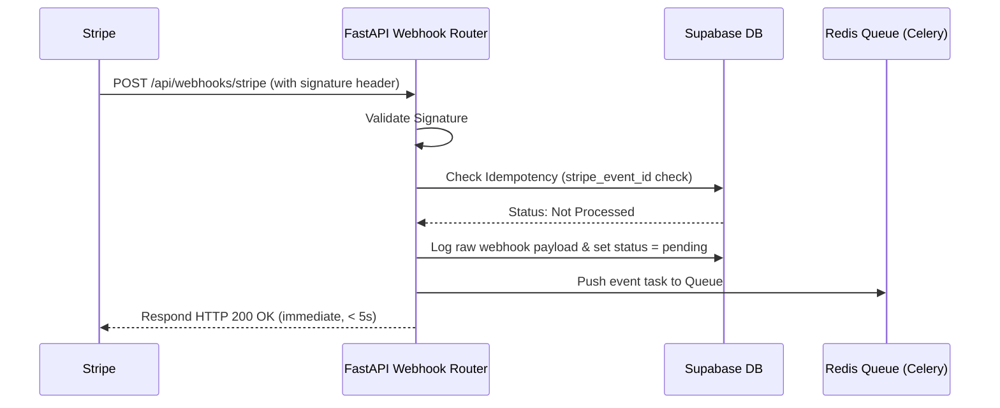

# Architecture Blueprint (Specification v1.0)

This blueprint documents the system data flows, Redis-PostgreSQL synchronization patterns, and background job queue designs.

## System Flow & Data Pipeline

```mermaid
graph TD
    Client[Client Browser / API Client] -->|API Call with Token| LB[Load Balancer]
    LB -->|Routing| FastAPI[FastAPI Backend]
    FastAPI -->|1. Auth & RBAC Check| Supabase[Supabase DB / PostgreSQL]
    FastAPI -->|2. Check / Increment Usage| Redis[(Redis Cache)]
    Redis -->|Soft / Hard Cap Limits| FastAPI
    
    FastAPI -->|Success| Client
    FastAPI -->|Limit Exceeded (429)| Client
    
    Cron[Hourly Cron Job] -->|Synchronize Usage| UsageTracker[Usage Tracker Service]
    UsageTracker -->|Fetch Redis Counters| Redis
    UsageTracker -->|Report Usage| Stripe[Stripe API]
    UsageTracker -->|Batch Write Logs| Supabase
```

### 1. Request Validation (Middleware Check)
1. **API Token Check**: Client includes bearer token. Backend resolves user status and limits.
2. **Redis Ingestion**: Token consumption is checked atomically in Redis using an active connection.
3. **Guardrail checks**: 
   - If usage >= hard limit and hard cap is enabled → reject with `HTTP 429 Too Many Requests`.
   - If usage reaches 80% / 90% soft limit → trigger non-blocking event to dispatch warning email.

### 2. High-Performance Usage Sync
- **Atomic Operations**: Redis `INCRBY` ensures zero race conditions during parallel requests.
- **Batch Synchronization**: Usage tracker does not execute a Postgres write on every call. It pushes writes in batches of 100 or on a periodic scheduler (e.g. hourly) to reduce write strain on Supabase DB connection pools.
- **Data Recovery**: In case of a temporary network drop to Stripe, Redis retains metrics and schedules retries.

---

## Stripe Webhook Pipeline

Stripe webhook calls are asynchronous to ensure maximum availability.



1. **Immediate Ack**: The Webhook handler responds with `HTTP 200` to Stripe within 5 seconds.
2. ** Celery Job Queue**: Celery workers consume events from Redis queue and execute side-effects (database updates, email notifications, dunning triggers).
3. **Idempotency Check**: The workers check if the event status is already set to `processed = true` in Postgres to avoid duplicate execution.
